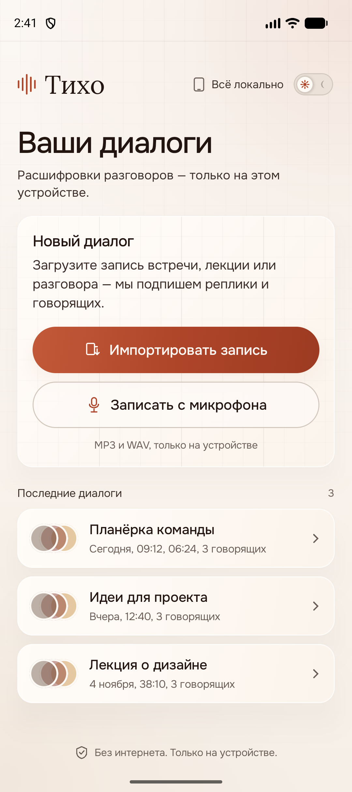
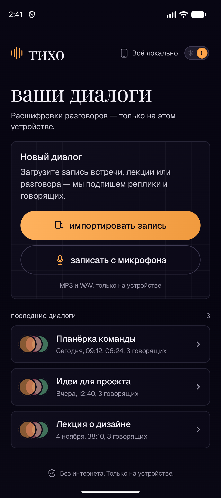
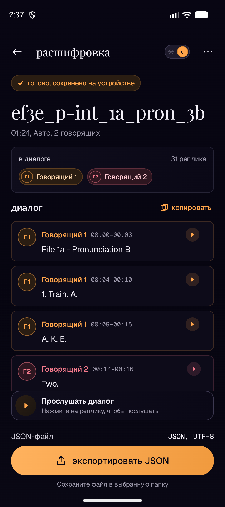

# Тихо — локальная расшифровка диалогов на Rust

Android-приложение для хакатона **Nuclear IT Hack**: импорт или запись разговора, распознавание речи, автоматическое разделение говорящих, таймкоды реплик и экспорт JSON. Вся обработка идёт на устройстве, без сети и облачных API.

Под капотом — Rust-ядро **`bridge-core`**: [whisper.cpp](https://github.com/ggerganov/whisper.cpp) через `whisper-rs` для ASR и **sherpa-onnx** (pyannote-сегментация + speaker embeddings) для диаризации. Kotlin вызывает Rust через **UniFFI + JNA**.

<p align="center">
  
  
</p>

<p align="center">
  
</p>

Видео с демонстрацией работы приложения находится в папке `artifacts/demo`

## Ссылки
- [Архитектура](#архитектура)
- [Установка](#установка)
- [Модели и размер](#модели-и-размер)
- [Соответствие требованиям](#соответствие-требованиям)
- [Зависимости](#зависимости)
- [Сборка](#сборка)
- [Ограничения](#ограничения)
- [Обработка данных](#обработка)
- [JSON](#JSON)
- [Запись](#запись)
- [Экраны](#экраны)
- [Дизайн](#дизайн)
- [Оптимизация](#оптимизация)
- [Структура](#структура)
- [Лицензии](#лицензии)

## Архитектура

```
ru.mephi.tikho (Compose UI)
        │
        ▼
TikhoViewModel
        │  TranscriptionEngine
        ▼
RustTranscriptionEngine
        ├── BridgeRuntime          копирует модель, готовит PCM, чистит кэш
        ├── uniffi.bridge_core     Kotlin ↔ Rust (JNA)
        │     ├── Engine           whisper.cpp / whisper-rs
        │     └── Session          VAD-нарезка, 5-секундные чанки, таймкоды
        └── SpeakerLabeler         sherpa-onnx: pyannote + 3D-Speaker
```

Rust-исходники лежат в [`bridge/`](bridge/), а в приложении — уже собранные `libbridge_core.so` для `arm64-v8a` и `x86_64`, сгенерированные UniFFI-биндинги и модели. Это позволяет собирать APK без Rust/NDK на машине.

## Установка

Приложение можно установить на странице [релизов](https://github.com/AstralFeniix/hackathon-mephi/releases)
Или собрать приложение самостоятельно в пункте [сборки](#сборка)

## Модели и размер

| Файл | Назначение | Размер |
|---|---|---|
| `assets/ggml-base.bin` | Whisper base, ASR | 147,9 МБ |
| `assets/diarization/segmentation.onnx` | pyannote segmentation | 6,0 МБ |
| `assets/diarization/embedding.onnx` | speaker embeddings | 28,3 МБ |
| `app/libs/sherpa-onnx-2.0.1.aar` | ONNX Runtime + JNI | 49,4 МБ |
| `jniLibs/*/libbridge_core.so` | Rust/whisper.cpp | ~3,4 МБ × 2 |
| `libs/jna-5.17.0.aar` | UniFFI transport, 16 KB-совместимый | 0,5 МБ |

Итоговый debug APK — **~285 МБ**. В нём две ABI: `arm64-v8a` и `x86_64`. Модели не сжимаются (`noCompress`), чтобы `AssetManager.openFd()` мог отдать их без распаковки.

## Соответствие требованиям

| Требование | Реализация |
|---|---|
| Android-приложение | Kotlin + Jetpack Compose |
| Локальная обработка | Rust/whisper.cpp + sherpa-onnx |
| Импорт аудио | WAV/MP3 |
| Запись с микрофона | `AudioRecord`, WAV 16 кГц mono |
| Распознавание речи | Whisper base |
| Автоматическая диаризация | Pyannote segmentation + speaker embeddings |
| Таймкоды реплик | `start_ms` / `end_ms` из Whisper |
| Просмотр диалога | Участники, цвета, реплики |
| Экспорт JSON | По схеме в разделе [JSON](#JSON) |
| Прогресс | По обработанному аудио |
| Переход к реплике | Play с `start_ms` выбранной реплики |

## Зависимости

  - Android Studio/JDK 17+
  - Android SDK 36

## Сборка

> **Git LFS:** файл `Android/app/src/main/assets/ggml-base.bin` (141 МБ) хранится в Git LFS. Перед клонированием установите Git LFS, а после клонирования выполните `git lfs pull`:
>
> ```powershell
> git lfs install
> git clone https://github.com/AstralFeniix/hackathon-mephi.git
> cd hackathon-mephi
> git lfs pull
> ```
>
> Без LFS вместо модели будет текстовый pointer-файл, и приложение не сможет загрузить Whisper.

```powershell
# из папки Android
.\gradlew.bat assembleDebug
# APK: app/build/outputs/apk/debug/app-debug.apk
```

Проверки:

```powershell
.\gradlew.bat testDebugUnitTest
.\gradlew.bat lintDebug
```

Если менялось Rust-ядро, пересоберите его из `bridge/`. Скрипт сразу кладёт `.so` и UniFFI-биндинги в `Android/`:

```powershell
cd bridge
.\scripts\build-android.ps1
```

Модели и `sherpa-onnx.aar` скачиваются один раз скриптом `bridge/scripts/fetch-diarization.ps1` в `Android/app/src/main/`.

## Ограничения

- **Скорость:** base-модель обрабатывает за несколько минут; первый запуск дольше из-за копирования и загрузки модели. Для ускорения можно заменить `ggml-base.bin` на `ggml-tiny.bin`, но точность упадёт.
- **Язык:** Whisper запускается с `language=auto`.
- **Диаризация:** На коротких/шумных записях число говорящих может быть оценено неточно.
- **Форматы импорта:** WAV/MP3.
- **Формат записи:** WAV 16 кГц mono.
- **Долгие записи:** Обработка идёт в одном foreground-корутине; при уходе с экрана текущий нативный чанк может докачиваться, но результат отбрасывается.
- **Хранение:** Список диалогов живёт в памяти и сбрасывается при перезапуске; JSON/аудио можно сохранить.
- **Размер APK:** ~285 МБ.

## Обработка

1. `AudioItem.uriString` превращается в локальный файл: `content://` копируется в кэш, запись из приложения уже лежит в `file://`.
2. `decodeToPcm()` (Symphonia) декодирует WAV/MP3 в **16 кГц mono f32**.
3. `Engine(ggml-base.bin)` загружается один раз. При первом запуске модель копируется из `assets/` в `filesDir` (148 МБ).
4. Аудио отдаётся в `Session.pushAudio()` чанками по 5 секунд. На каждом чанке обновляются прогресс и уже готовые реплики; `finish()` забирает хвост.
5. `SpeakerLabeler.label()` прогоняет полный аудиопоток через sherpa-onnx, получает `SpeakerTurn`. `labelSpeakers()` склеивает близкие отрезки одного говорящего, убирает короткие вставки и делит реплики Whisper по смене говорящего, используя таймкоды слов.
6. UI строит `Utterance` с `speaker_id`, `start_ms`, `end_ms`, `text`; экран результата и JSON используют одну и ту же модель.

## JSON

```json
{
  "transcript": [
    {
      "speaker_id": "speaker_1",
      "start_ms": 0,
      "end_ms": 4000,
      "text": "File 1A - Pronunciation B"
    },
    {
      "speaker_id": "speaker_2",
      "start_ms": 14525,
      "end_ms": 16525,
      "text": "Two."
    }
  ]
}
```

Сохранение — через системный `CreateDocument("application/json")`, UTF-8. Кнопка «Экспортировать JSON» находится на экране результата; копирование и «Поделиться» используют тот же диалог.

## Запись

- Пишем **WAV 16 кГц mono PCM16** через `AudioRecord`, а не M4A: этот формат напрямую принимает Rust-декодер и он же нужен Whisper/sherpa.
- Разрешение `RECORD_AUDIO` запрашивается только при нажатии «Начать запись».
- Таймер и индикация — из реального состояния контроллера; при отмене файл удаляется.
- `MediaPlayer` на экране проверки играет WAV и импортированные MP3/WAV; перемотка по волне работает.
- Импортируются **WAV и MP3**.

## Экраны

| Экран | Файл | Что делает |
|---|---|---|
| Ваши диалоги | `ui/screens/LibraryScreen.kt` | импорт, запись, последние диалоги |
| Запись | `ui/screens/RecordingScreen.kt` | WAV-запись, разрешение, таймер |
| Запись готова | `ui/screens/ReadyScreen.kt` | прослушивание, перемотка, авто-язык, модель |
| Обработка | `ui/screens/ProcessingScreen.kt` | прогресс по аудио, этапы, живые реплики, ошибки/retry |
| Расшифровка | `ui/screens/ResultScreen.kt` | участники, реплики, play с таймкода, JSON |

## Дизайн

Две темы из библиотеки Hallmark:

- **Светлая — Bloom.** Тёплая бумага `#F9F4EE`, умбра `#221510`, терракота `#AF4529`; Onest для голов и текста, один римский момент Lora в слове «Тихо». Мягкие поднятые карты 18 px, пилюли-кнопки, тихая сетка «пиано-ролла» в карточке-сцене и две неподвижные терракотовые «розы» на фоне.
- **Тёмная — Lumen.** Фиолетово-чёрная ночь `#060510`, костяные чернила `#F3F0F8`, латунь `#FFA54B` и одна роза `#F3798B`; Playfair Display строчными для голов, Geist для текста, Geist Mono для таймкодов. Плоские well'ы 10 px с волосяной линией, чертёжная сетка только внутри карточек, без свечения и ореолов.
- Переключатель темы справа в верхней панели на всех экранах; выбор сохраняется в `SharedPreferences`.
- Диалог — это беседа: аватар с инициалами, имя, диапазон времени, мягкий цветовой фон. Пока модель не знает имён, участники называются «Говорящий 1», «Говорящий 2» — это честнее, чем подставлять случайные имена.
- Шрифты лежат в `app/src/main/res/font/` и работают офлайн: Onest, Lora, Playfair Display, Geist и Geist Mono (Google Fonts, OFL). Все с кириллицей. Лицензии — в `Android/docs/font-licenses.md`, разбор тем — в `Android/docs/design-themes.md`.

## Оптимизация

- `LazyColumn` с `key`/`contentType` для списка диалогов и ленты реплик.
- Processing показывает только последние 8 live-реплик, чтобы карточка не росла на сотни элементов.
- Прогресс обновляется по реально обработанным 5-секундным чанкам.
- Модель и диаризатор загружаются лениво и переиспользуются; повторная расшифровка не копирует 148 МБ заново.
- Позиция плеера читается только в компоненте волны/времени; `derivedStateOf` не даёт перерисовывать весь экран.
- Модели `AudioItem`, `Speaker`, `Utterance`, `Recording` помечены `@Immutable`.
- Тяжёлые вызовы идут на `Dispatchers.Default`; Compose-состояние обновляется на Main.

## Структура

```
hackathon-mephi/
├── Android/                       # Android-приложение (Compose)
│   ├── app/src/main/
│   │   ├── assets/ggml-base.bin
│   │   ├── assets/diarization/*.onnx
│   │   ├── jniLibs/{arm64-v8a,x86_64}/*.so
│   │   ├── libs/{jna-5.17.0,sherpa-onnx-2.0.1}.aar
│   │   ├── res/font/*.ttf        # Ranade, Gambarino, Instrument Serif, Geist
│   │   ├── java/uniffi/bridge_core/bridge_core.kt
│   │   └── java/ru/mephi/tikho/
│   │       ├── data/bridge/BridgeRuntime.kt
│   │       ├── data/bridge/RustTranscriptionEngine.kt
│   │       ├── data/bridge/SpeakerLabeler.kt
│   │       ├── data/TranscriptionEngine.kt
│   │       ├── ui/theme/...      # Bloom / Lumen
│   │       └── ui/screens/...
│   └── docs/screenshots/
├── bridge/                        # Rust workspace
│   ├── crates/
│   └── scripts/
└── README.md
```

## Лицензии

- whisper.cpp / whisper-rs — MIT.
- sherpa-onnx — Apache-2.0.
- JNA — Apache-2.0/LGPL.
- Шрифты: Onest, Lora, Playfair Display, Geist и Geist Mono — SIL Open Font License 1.1.
- Модели Whisper и pyannote/3D-Speaker — по лицензиям апстримов.
- Android-код проекта — в составе `hackathon-mephi`.
