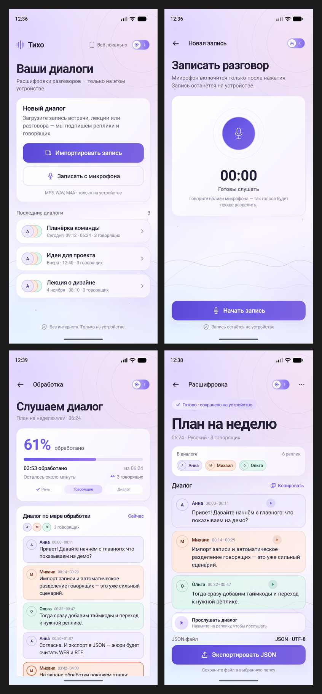
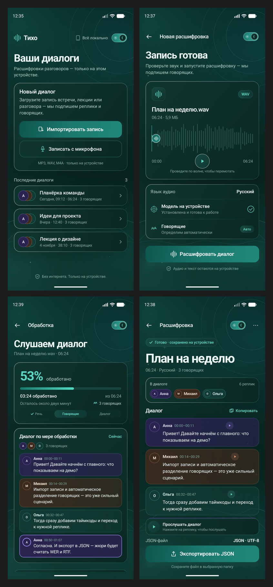
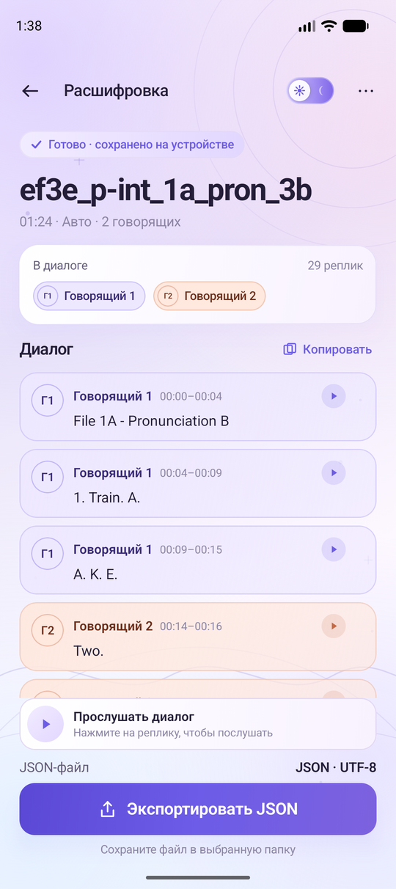

# Тихо — локальная расшифровка диалогов на Rust

Android-приложение для хакатона **Nuclear IT Hack**: импорт или запись разговора, распознавание речи, автоматическое разделение говорящих, таймкоды реплик и экспорт JSON. Вся обработка идёт на устройстве, без сети и облачных API.

Под капотом — Rust-ядро **`bridge-core`**: [whisper.cpp](https://github.com/ggerganov/whisper.cpp) через `whisper-rs` для ASR и **sherpa-onnx** (pyannote-сегментация + speaker embeddings) для диаризации. Kotlin вызывает Rust через **UniFFI + JNA**.

> **Реальный прогон:** MP3 01:24 → 29 реплик, 2 говорящих, таймкоды и JSON-экспорт. UI при этом остаётся прежним — это тот же экран «Расшифровка», что и на макетах.

<p align="center">
  
  
</p>

<p align="center">
  
  <br/>
  <em>Реальный результат: 29 реплик, 2 говорящих, язык «Авто».</em>
</p>

> Верхние превью показывают оформление на демонстрационном диалоге; ниже — настоящий прогон Rust-ядра.

## Архитектура

```
ru.mephi.tikho (Compose UI)
        │
        ▼
TikhoViewModel
        │  TranscriptionEngine
        ▼
RustTranscriptionEngine
        ├── BridgeRuntime          копирует модель, готовит PCM, чистит кэш
        ├── uniffi.bridge_core     Kotlin ↔ Rust (JNA)
        │     ├── Engine           whisper.cpp / whisper-rs
        │     └── Session          VAD-нарезка, 5-секундные чанки, таймкоды
        └── SpeakerLabeler         sherpa-onnx: pyannote + 3D-Speaker
```

Rust-исходники лежат в [`bridge/`](bridge/), а в приложении — уже собранные `libbridge_core.so` для `arm64-v8a` и `x86_64`, сгенерированные UniFFI-биндинги и модели. Это позволяет собирать APK без Rust/NDK на машине.

## Как идёт обработка

1. `AudioItem.uriString` превращается в локальный файл: `content://` копируется в кэш, запись из приложения уже лежит в `file://`.
2. `decodeToPcm()` (Symphonia) декодирует WAV/MP3 в **16 кГц mono f32**.
3. `Engine(ggml-base.bin)` загружается один раз. При первом запуске модель копируется из `assets/` в `filesDir` (148 МБ).
4. Аудио отдаётся в `Session.pushAudio()` чанками по 5 секунд. На каждом чанке обновляются прогресс и уже готовые реплики; `finish()` забирает хвост.
5. `SpeakerLabeler.label()` прогоняет полный аудиопоток через sherpa-onnx, получает `SpeakerTurn` и `labelSpeakers()` переносит `speaker_id` на реплики Whisper.
6. UI строит `Utterance` с `speaker_id`, `start_ms`, `end_ms`, `text`; экран результата и JSON используют одну и ту же модель.

## Модели и размер

| Файл | Назначение | Размер |
|---|---|---|
| `assets/ggml-base.bin` | Whisper base, ASR | 147,9 МБ |
| `assets/diarization/segmentation.onnx` | pyannote segmentation | 6,0 МБ |
| `assets/diarization/embedding.onnx` | speaker embeddings | 28,3 МБ |
| `app/libs/sherpa-onnx-2.0.1.aar` | ONNX Runtime + JNI | 49,4 МБ |
| `jniLibs/*/libbridge_core.so` | Rust/whisper.cpp | ~3,4 МБ × 2 |
| `libs/jna-5.17.0.aar` | UniFFI transport, 16 KB-совместимый | 0,5 МБ |

Итоговый debug APK — **~285 МБ**. В нём две ABI: `arm64-v8a` и `x86_64`. Модели не сжимаются (`noCompress`), чтобы `AssetManager.openFd()` мог отдать их без распаковки.

## Соответствие требованиям

| Требование | Реализация |
|---|---|
| Android-приложение | ✅ Kotlin + Jetpack Compose |
| Локальная обработка | ✅ Rust/whisper.cpp + sherpa-onnx, без `INTERNET` |
| Импорт аудио | ✅ SAF, WAV/MP3 |
| Запись с микрофона | ✅ `AudioRecord`, WAV 16 кГц mono |
| Распознавание речи | ✅ Whisper base на устройстве |
| Автоматическая диаризация | ✅ pyannote segmentation + speaker embeddings |
| Таймкоды реплик | ✅ `start_ms` / `end_ms` из Whisper |
| Просмотр диалога | ✅ участники, цвета, реплики |
| Экспорт JSON | ✅ ровно схема хакатона |
| Прогресс | ✅ по обработанному аудио + этапы |
| Переход к реплике | ✅ play с `start_ms` выбранной реплики |
| Офлайн | ✅ нет разрешения `INTERNET` |
| Оптимизация | ✅ lazy-списки, чанки, scoped-состояние, кэш моделей |

## JSON

`Recording.toJson()` отдаёт ровно такой документ:

```json
{
  "transcript": [
    {
      "speaker_id": "speaker_1",
      "start_ms": 0,
      "end_ms": 4000,
      "text": "File 1A - Pronunciation B"
    },
    {
      "speaker_id": "speaker_2",
      "start_ms": 14525,
      "end_ms": 16525,
      "text": "Two."
    }
  ]
}
```

Сохранение — через системный `CreateDocument("application/json")`, UTF-8. Кнопка «Экспортировать JSON» находится на экране результата; копирование и «Поделиться» используют тот же диалог. Полный файл реального прогона: [`docs/real-transcript.json`](docs/real-transcript.json).

## Запись

- Пишем **WAV 16 кГц mono PCM16** через `AudioRecord`, а не M4A: этот формат напрямую принимает Rust-декодер и он же нужен Whisper/sherpa.
- Разрешение `RECORD_AUDIO` запрашивается только при нажатии «Начать запись».
- Таймер и индикация — из реального состояния контроллера; при отмене файл удаляется.
- `MediaPlayer` на экране проверки играет WAV и импортированные MP3/WAV; перемотка по волне работает.
- Импортируются **WAV и MP3**. M4A/AAC не декодируется Symphonia в этой сборке; для записи внутри приложения это не проблема, потому что мы сразу пишем WAV.

## Экраны

| Экран | Файл | Что делает |
|---|---|---|
| Ваши диалоги | `ui/screens/LibraryScreen.kt` | импорт, запись, последние диалоги |
| Запись | `ui/screens/RecordingScreen.kt` | WAV-запись, разрешение, таймер |
| Запись готова | `ui/screens/ReadyScreen.kt` | прослушивание, перемотка, авто-язык, модель |
| Обработка | `ui/screens/ProcessingScreen.kt` | прогресс по аудио, этапы, живые реплики, ошибки/retry |
| Расшифровка | `ui/screens/ResultScreen.kt` | участники, реплики, play с таймкода, JSON |

## Дизайн

- **Светлая тема** — лаванда `#E6E6FA`, фиолетовый акцент, мягкие градиенты и свечения.
- **Тёмная тема** — глубокий бирюзовый `#1B796E`, бирюзовые блики.
- Фон рисуется на Canvas: градиент, световые пятна, круги, волны, точки и искры.
- Переключатель темы справа в верхней панели на всех экранах; выбор сохраняется.
- Диалог — это беседа: аватар с инициалами, имя, диапазон времени, мягкий цветовой фон. Пока модель не знает имён, участники называются «Говорящий 1», «Говорящий 2» — это честнее, чем подставлять случайные имена.

## Оптимизация

- `LazyColumn` с `key`/`contentType` для списка диалогов и ленты реплик.
- Processing показывает только последние 8 live-реплик, чтобы карточка не росла на сотни элементов.
- Прогресс обновляется по реально обработанным 5-секундным чанкам, а не таймером.
- Модель и диаризатор загружаются лениво и переиспользуются; повторная расшифровка не копирует 148 МБ заново.
- Позиция плеера читается только в компоненте волны/времени; `derivedStateOf` не даёт перерисовывать весь экран.
- Модели `AudioItem`, `Speaker`, `Utterance`, `Recording` помечены `@Immutable`.
- Тяжёлые вызовы идут на `Dispatchers.Default`; Compose-состояние обновляется на Main.

## Сборка

Нужны Android Studio/JDK 17+ и Android SDK 36. Rust/NDK для обычной сборки **не нужны** — нативные библиотеки уже в проекте.

> **Git LFS:** файл `UI/app/src/main/assets/ggml-base.bin` (141 МБ) хранится в Git LFS. Перед клонированием установите Git LFS, а после клонирования выполните `git lfs pull`:
>
> ```powershell
> git lfs install
> git clone https://github.com/AstralFeniix/hackathon-mephi.git
> cd hackathon-mephi
> git lfs pull
> ```
>
> Без LFS вместо модели будет текстовый pointer-файл, и приложение не сможет загрузить Whisper.

```powershell
# из папки UI
.\gradlew.bat assembleDebug
# APK: app/build/outputs/apk/debug/app-debug.apk
```

Проверки:

```powershell
.\gradlew.bat testDebugUnitTest
.\gradlew.bat lintDebug
```

Если менялось Rust-ядро, сначала пересоберите его в `bridge/`:

```powershell
cd bridge
.\scripts\build-android.ps1
```

Затем синхронизируйте артефакты в UI:

```powershell
cd ..
.\scripts\sync-bridge.ps1
```

Скрипт копирует `.so`, модели, UniFFI-биндинги, `sherpa-onnx.aar` и скачивает `jna-5.17.0.aar`, если его нет.

## Проверено

- `assembleDebug` — успешно; APK `0.4.0`.
- `testDebugUnitTest` — успешно.
- `lintDebug` — **0 ошибок** (для сгенерированного UniFFI-файла подавлен ложный `NewApi`: там есть runtime-fallback на JNA).
- Реальный прогон на эмуляторе x86_64: `ef3e_p-int_1a_pron_3b.mp3` (01:24) → 29 реплик, 2 говорящих, JSON сохранён и проверен.
- Запись WAV проверена отдельно: заголовок RIFF, 16 кГц, mono, 16 бит.
- Модель копируется в `filesDir` один раз; повторный запуск использует её без копирования.

## Ограничения

- **Скорость:** base-модель на эмуляторе обрабатывает 1:24 за несколько минут; первый запуск дольше из-за копирования и загрузки модели. Для ускорения можно заменить `ggml-base.bin` на `ggml-tiny.bin` (имя файла и код не меняются), но точность упадёт.
- **Язык:** Whisper запускается с `language=auto`; интерфейс показывает «Авто». Отдельного выбора языка пока нет.
- **Диаризация:** порог кластеризации 0.5; на коротких/шумных записях число говорящих может быть оценено неточно. Имена — «Говорящий N», переименования нет.
- **Форматы импорта:** WAV/MP3. M4A/AAC не поддерживается Symphonia в текущей сборке.
- **Формат записи:** WAV 16 кГц mono; приложение пишет именно его, поэтому запись + расшифровка работают без перекодирования.
- **Долгие записи:** обработка идёт в одном foreground-корутине; при уходе с экрана текущий нативный чанк может докачиваться, но результат отбрасывается. Фонового сервиса нет.
- **Хранение:** список диалогов живёт в памяти и сбрасывается при перезапуске; JSON/аудио можно сохранить.
- **Размер APK:** ~285 МБ из-за моделей и двух ABI. Для Google Play нужен App Bundle/доставка моделей отдельно.

## Структура

```
UI/
├── app/src/main/
│   ├── assets/ggml-base.bin
│   ├── assets/diarization/*.onnx
│   ├── jniLibs/{arm64-v8a,x86_64}/*.so
│   ├── libs/{jna-5.17.0,sherpa-onnx-2.0.1}.aar
│   ├── java/uniffi/bridge_core/bridge_core.kt
│   └── java/ru/mephi/tikho/
│       ├── data/bridge/BridgeRuntime.kt
│       ├── data/bridge/RustTranscriptionEngine.kt
│       ├── data/bridge/SpeakerLabeler.kt
│       ├── data/TranscriptionEngine.kt
│       ├── ui/screens/...
│       └── ...
├── bridge/                    # Rust workspace + Android-прототип
├── scripts/sync-bridge.ps1
└── docs/screenshots/
```

## Лицензии

- whisper.cpp / whisper-rs — MIT.
- sherpa-onnx — Apache-2.0.
- JNA — Apache-2.0/LGPL.
- Модели Whisper и pyannote/3D-Speaker — по лицензиям апстримов; при распространении APK проверьте условия моделей.
- UI-код проекта — в составе `hackathon-mephi`.

## Отчётные материалы

- Исходники Android UI — `app/`.
- Rust-ядро — `bridge/`.
- APK — `app/build/outputs/apk/debug/app-debug.apk`.
- Этот README + скриншоты в `docs/screenshots/`.
- Видео-демонстрацию нужно записать отдельно; в репозитории её нет.
